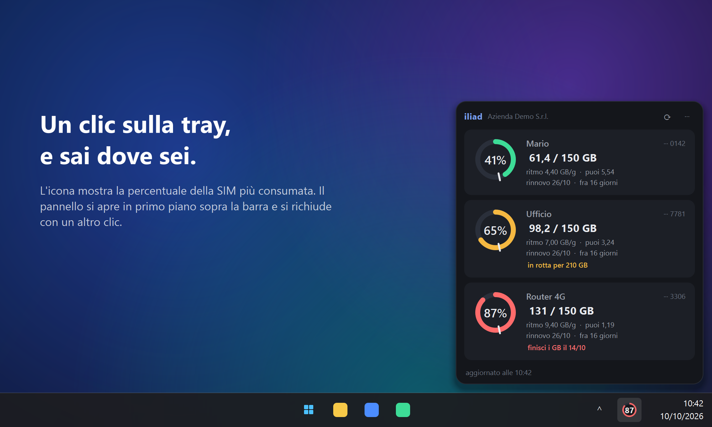
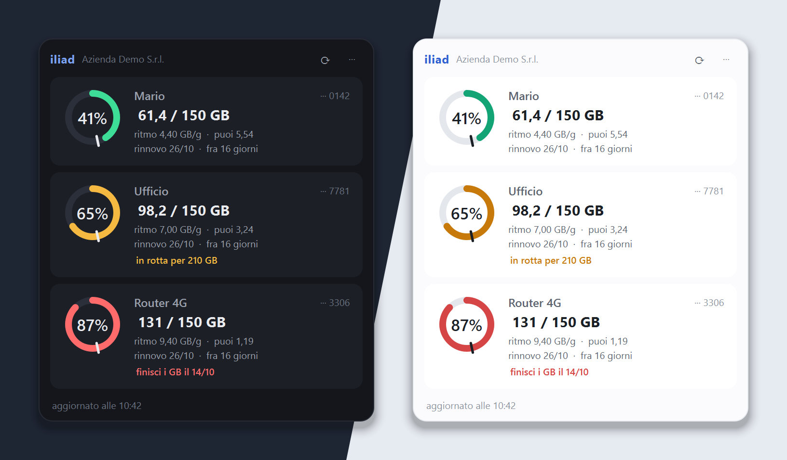
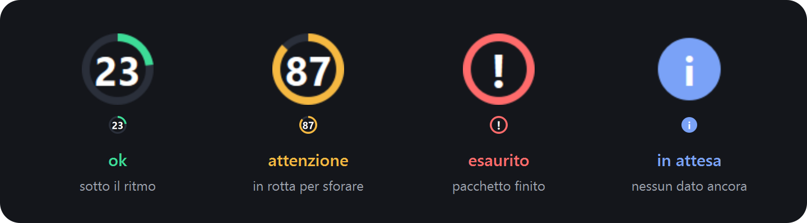
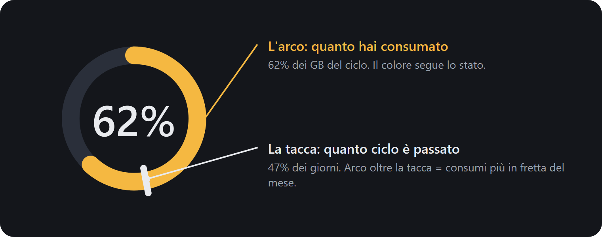
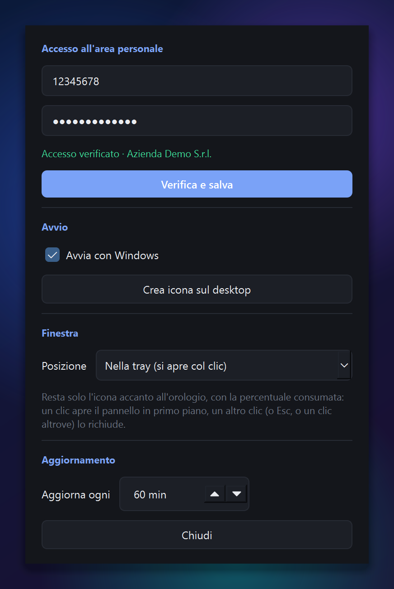

<p align="center">
  
</p>

<p align="center">
  <a href="../../releases/latest"></a>
  <a href="../../releases"></a>
  
  
  <a href="../../actions/workflows/ci.yml"></a>
  <a href="LICENSE"></a>
</p>

<p align="center">
  Widget per Windows che mostra i contatori delle SIM <strong>iliad business</strong>:<br>
  quanti GB hai consumato, a che ritmo, e se a fine ciclo ci arrivi o sfori.
</p>

<p align="center">
  <a href="../../releases/latest"><strong>⬇ Scarica l'installer</strong></a>
  &nbsp;·&nbsp;
  <a href="#cosa-fa">Cosa fa</a>
  &nbsp;·&nbsp;
  <a href="#installazione">Installazione</a>
  &nbsp;·&nbsp;
  <a href="#credenziali-e-privacy">Privacy</a>
</p>

<p align="center">
  
</p>

Gira in locale, non manda niente a nessuno, non serve tenere aperto il browser.

## Cosa fa

| | |
|---|---|
| 📶 **Una scheda per SIM** | tutte le SIM del tuo account, lette da sole dal portale: non devi elencarle a mano |
| ⏱️ **Ritmo** | media di GB al giorno consumati finora nel ciclo |
| 🎯 **Puoi** | quanto puoi ancora spendere al giorno per arrivare al rinnovo senza sforare |
| 🔔 **Notifiche** | avviso di Windows all'80% e al 95% del pacchetto, e quando la proiezione sfora |
| 🖥️ **Dove vuoi tu** | sul desktop come i Memo, finestra normale, sempre in primo piano o **solo nella tray** |
| 🌗 **Tema automatico** | chiaro o scuro, segue quello di Windows |

Anche le date del ciclo arrivano dal portale, quindi una SIM attivata a metà
mese si allinea da sola.

<p align="center">
  
</p>

### L'icona nella tray

L'icona disegna l'anello e la percentuale della SIM più consumata, col colore
dello stato peggiore: la guardi di sfuggita e sai già se va tutto bene. Passaci
sopra col mouse per il dettaglio di ogni SIM; un clic apre il pannello.

<p align="center">
  
</p>

### Come si legge l'anello

<p align="center">
  
</p>

L'arco colorato è il consumo. La **tacca** sullo stesso anello è quanto ciclo è
passato. Arco oltre la tacca = stai consumando più in fretta di quanto scorra il
mese.

## Installazione

### Con l'installer (consigliato)

Scarica `iliad-counter-setup-X.Y.Z.exe` dall'ultima
[Release](../../releases/latest) e lancialo. Non serve avere Python.

Si installa per il solo utente corrente in `%LOCALAPPDATA%\Programs`, quindi
non chiede diritti di amministratore. Durante l'installazione puoi spuntare
l'icona sul desktop e l'avvio automatico con Windows.

> 🔏 Il setup è **firmato digitalmente**: Windows mostra l'editore verificato.
> Se con una versione appena uscita SmartScreen avvisa comunque, *Ulteriori
> informazioni* → *Esegui comunque*.

### Dai sorgenti

Serve Windows 10/11 e Python 3.11 o superiore.

```powershell
git clone https://github.com/emanueleparini/Iliad-Business-Counter.git
cd Iliad-Business-Counter

python -m venv .venv
.venv\Scripts\python.exe -m pip install -r requirements.txt
.venv\Scripts\python.exe -m install.make_icon
.venv\Scripts\python.exe -m install.autostart --desktop
```

L'ultima riga crea l'icona **iliad counter** sul desktop. Doppio click e parte.

## Primo avvio

Si apre il pannello impostazioni: metti ID utente e password del portale e premi
**Verifica e salva**. Il salvataggio avviene solo se l'accesso funziona davvero.



Dallo stesso pannello (icona nella tray → *Impostazioni*, oppure il bottone ⋯):

- **Avvia con Windows**
- **Crea icona sul desktop**
- **Posizione** della finestra: *sul desktop* (sotto tutto, non copre mai il
  lavoro), *finestra normale*, *sempre in primo piano*, *nella tray* (resta
  solo l'icona: un clic apre il pannello in primo piano sopra la barra, un
  altro clic, Esc, ✕ o un clic altrove lo richiude). Si cambia al volo anche
  dalla tray → *Posizione*, e resta scritta in `config.toml` (`window_layer`).
- **Aggiorna ogni N minuti**

> L'icona nella tray su Windows 11 nasce **nascosta sotto la freccetta**: per
> averla sempre in vista, *Impostazioni di Windows → Personalizzazione → Barra
> delle applicazioni → Altre icone nell'area di notifica* e attiva
> *iliad counter*. Scegliendo la posizione *nella tray* il widget prova a
> metterla in vista da solo.

<br clear="right">

## Credenziali e privacy

- la password finisce nel **Windows Credential Manager**, cifrata con DPAPI e
  leggibile solo dal tuo account Windows
- non viene mai scritta in un file del progetto
- i dati dei consumi restano in una cartella `data/` sul tuo PC (mai versionata)
- nessuna telemetria, nessun server di terze parti: solo tu e il portale iliad

## Configurazione

Tutto in `config.toml`: intervallo di aggiornamento, soglie di notifica,
posizione e larghezza del widget. Puoi anche aggiungere un blocco `[[sim]]` per
dare un'etichetta tua a una SIM o deciderne l'ordine, ma non è obbligatorio.

Il file nasce da solo al primo avvio, copiato da `config.example.toml`:

| come hai installato | dove sta `config.toml` |
|---|---|
| installer | `%LOCALAPPDATA%\iliad counter\` (con `data/` accanto) |
| dai sorgenti | nella cartella del progetto |

## Uso da riga di comando (facoltativo)

```powershell
.venv\Scripts\python.exe -m collector.run            # un controllo al volo
.venv\Scripts\python.exe -m collector.run --watch --json
```

---

<details>
<summary><strong>Dettagli tecnici</strong></summary>

### Come parla col portale

`business.iliad.it` è una SPA Vue appoggiata a un'API REST (API Platform /
Symfony). L'accesso è un `POST /api/login` che risponde con un cookie di
sessione `ACC_SESSID`; da lì in poi bastano richieste HTTP normali.

| endpoint | cosa dà |
|---|---|
| `POST /api/login` | sessione |
| `GET /api/me` | utente, azienda |
| `GET /api/companies/{id}/lines` | elenco SIM |
| `GET /api/lines/{uuid}/counters` | consumi + periodo di riferimento |
| `GET /api/lines/{uuid}/info` | data di rinnovo, stato attivazione |

### Struttura

```
core/       logica pura, indipendente dal portale
  api.py          client HTTP + credenziali nel Credential Manager
  parse.py        "233.0GB" -> 233.0 ; "Illimitati" -> inf
  cycle.py        cicli di fatturazione e proiezioni
  snapshot.py     da risposte API a dizionario per il widget
  store.py        latest.json (atomico) + storico SQLite
  config.py       lettura di config.toml
collector/  raccolta dati da riga di comando
widget/     interfaccia PySide6
install/    icona, collegamenti, avvio con Windows
recon/      ricognizione del portale (serve solo se l'API cambia)
```

Se iliad cambia l'API, i file da toccare sono `core/snapshot.py` e
`core/api.py`. Il resto non sa nulla di iliad.

### Test

```powershell
.venv\Scripts\python.exe -m core.test_cycle
.venv\Scripts\python.exe -m core.test_parse
```

### Build dell'installer

```powershell
.venv\Scripts\python.exe -m pip install pyinstaller
.\build.ps1 -Version 1.1.0          # exe + setup in dist/
.\build.ps1 -Version 1.1.0 -Sign    # idem, firmati con Azure Artifact Signing
```

La firma richiede il Windows SDK (signtool) e un login Azure CLI con il ruolo
*Artifact Signing Certificate Profile Signer* sull'account indicato in
`packaging/artifact-signing.json`:
`az login --scope https://codesigning.azure.net/.default`.

Il setup esce in `dist/installer/`. In automatico lo fa GitHub Actions: un tag
`vX.Y.Z` fa partire `.github/workflows/release.yml`, che builda su Windows e
allega l'installer alla Release.

```powershell
git tag v1.0.0
git push --tags
```

### Immagini del README

```powershell
.venv\Scripts\python.exe -m widget._readme_shots
```

Le renderizza dal codice vero del widget, con dati inventati, in `docs/img/`.
Da rilanciare quando cambia la grafica.

### Ricognizione del portale

```powershell
.venv\Scripts\python.exe recon\recon.py
```

Apre un Chromium visibile, registra le chiamate di rete mentre navighi e alla
chiusura genera `recon/artifacts/REPORT.md`. Password e token non finiscono mai
nei log.

</details>

---

Progetto non ufficiale, senza alcun legame con iliad.
